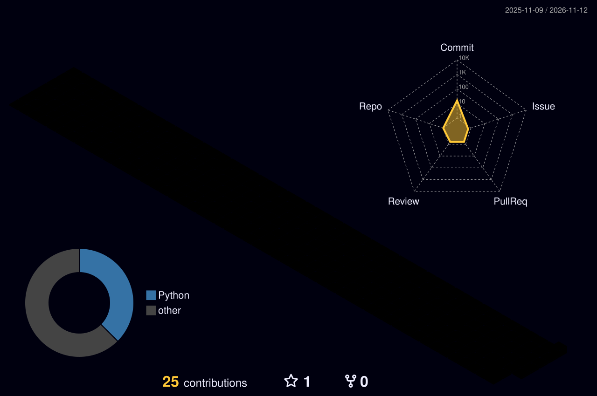

## Rafael
**`Desenvolvedor`**

  <!-- banner animado / digitação -->
    

  

  
  
  
  
  
  
  
  

  

## 👨‍💻 Sobre Mim

<table>
  <tr>
    <td width="60%">
      Estudante de <strong>Engenharia de Software</strong> com foco prático em engenharia de sistemas. Explorando novos horizontes tecnológicos, transito livremente entre aplicações web, sistemas embarcados, motores gráficos, desenvolvimento de games e inteligência artificial.  
      >_ Atualmente desenvolvendo o <strong>Acessa Prudente</strong> e soluções imersivas de acessibilidade e mapa colaborativa.  
      >_ Interesses: Engenharia de Sistemas, Web Dev, Motores Gráficos, LLMs e Computação Gráfica.  
      >_ Sempre em busca de novos conhecimentos, unindo a prática de mercado com o rigor técnico do meio acadêmico para formar um perfil de profissional que <strong>Idealizo</strong>.
    </td>
    <td width="35%" align="center">
      <!-- GIF animado do perfil -->
      
    </td>
  </tr>
</table>

  

  

  

  

  

